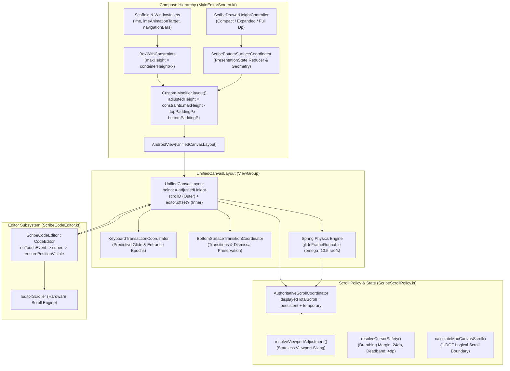

# SCROLL_ARCHITECTURE_AUDIT: Scribe Native Viewport & Scrolling Architecture

---

## 1. Current Repository HEAD

- **Inspected Commit SHA**: `6585cca6f2944b685cc4f4213da44fa9cc737ab3`
- **Branch**: `main`
- **Starting Point**: `a3b1dedcf2c6784aa849ed1abe06454d88a012f7`
- **Reference Commits Examined**:
  - `d0d39b5`: Original behavioral reference (Pure Writer bottom space, stationary dismissal, fluid shortcut bar entry)
  - `475177f`: Unnecessary cursor movement elimination and coordinated IME entrance
  - `c7fe7fa`: Mid-flight predictive glide stabilization and tap entrance
  - `6f75981`: Expanded-state scrolling and keyboard-entrance jump fixes
  - `00b8d58`: Replacement of expansion compensation ledger with viewport-driven scrolling
  - `0b3a48c`: Compensation invalidation preservation and viewport settlement flow
  - `a3b1ded`: Viewport adjustment settlement completion in glide frame loop
  - `6585cca`: Elimination of double-subtraction in viewport evaluation, baseline capture ordering correction, and committed caret resolution

---

## 2. Architecture Overview

Scribe implements a hybrid Compose-AndroidView architecture designed to provide a rich text-editing canvas with an edge-to-edge window, a collapsible note header, a code/prose editor (Rosemoe's Sora Editor), a contextual shortcut accessory bar, and expandable drawers.



### The 1-DOF Canvas Coordinate Model
The document layout does not embed Sora in an Android `ScrollView` (which would disrupt Sora's tile recycling and hardware line rendering). Instead, `UnifiedCanvasLayout` implements a **Single Degree of Freedom (1-DOF)** compound coordinate system:
1. **Outer Scroll (`scrollD`)**: Translates `headerView` (ComposeView containing note title, tags, date) and `editor` (Sora view) vertically between `0` and `headerHeight`.
2. **Inner Scroll (`editor.offsetY`)**: Sora's internal hardware line offset managed by its native `EditorScroller`.
3. **Strict Invariant**:
   $$\text{Total Logical Scroll} = \text{scrollD} + \text{editor.offsetY}$$
   If $\text{scrollD} < \text{headerHeight}$, then $\text{editor.offsetY} \equiv 0$. The editor's text content never begins scrolling internally until the note header has completely translated off-screen.

### The Dual-Value Viewport-Driven Scroll Model
Introduced in commit `00b8d58`, the scrolling policy separates long-term document position from temporary UI contractions:
$$\text{displayedTotalScroll} = \text{persistentScrollPosition} + \text{temporaryViewportAdjustment}$$
- `persistentScrollPosition`: The actual canonical scroll position within the document. Updated by user drags, flings, and intentional cursor visibility requirements.
- `temporaryViewportAdjustment`: Transient upward displacement applied *only* when a bottom surface (accessory drawer or oversized IME picker) expands beyond standard baseline. When the surface contracts back to normal, this term smoothly returns to `0f`, restoring the original viewport without leaving residual scroll offset.

---

## 3. Mutable Scrolling State Ownership Table

| State Variable | Owning Class & File | Purpose | Other Modifying Components | Duplicate / Overlapping State |
| :--- | :--- | :--- | :--- | :--- |
| `scrollD` / `scrollDFloat` | `UnifiedCanvasLayout.kt` (lines 751-754) | Current outer header translation ($0 \le \text{scrollD} \le \text{headerHeight}$). | `scrollCanvasBy()`, `jumpScrollTo()`, `onMeasure()` reconciliation. | Overlaps with `scrollCoordinator.totalScroll`. |
| `editor.offsetY` | `CodeEditor.java` / `ScribeCodeEditor.kt` | Internal Sora text scroll offset. | `dispatchScrollToEditor()`, Sora's `EditorScroller`, `jumpScrollTo()`. | Component of `displayedTotalScroll`. |
| `persistentScrollPosition` | `AuthoritativeScrollCoordinator` (`ScribeScrollPolicy.kt:1495`) | Authoritative canonical document scroll offset. | `recordUserScrollDelta()`, `onViewportAdjustmentSettled()`, `evaluateViewportAdjustment()`. | Represents the persistent portion of `scrollD + editor.offsetY`. |
| `temporaryViewportAdjustment` | `AuthoritativeScrollCoordinator` (`ScribeScrollPolicy.kt:1496`) | Temporary upward displacement for expanded surfaces. | `applyStep()`, `evaluateViewportAdjustment()`, `onViewportAdjustmentSettled()`. | Overlaps with `transitionCoordinator.compensation.remainingDisplacement`. |
| `genericRetainedScroll` | `UnifiedCanvasLayout.kt` (line 71) | Preserves stationary document offset when keyboard collapses. | `completeTerminalDismissal()`, `checkAndClearPreservedDismissalScroll()`. | Overlaps with `transitionCoordinator.preservedDismissalScroll`. |
| `preservedDismissalScroll` (getter/setter) | `UnifiedCanvasLayout.kt` (lines 82-86) | Computed property alias for dismissal preservation. | Delegates to `transitionCoordinator.preservedScroll ?: genericRetainedScroll`. | **Duplicate**: Exposes two redundant storage locations for the same preserved scroll value. |
| `isKeyboardDismissing` | `UnifiedCanvasLayout.kt` (lines 88-99) | Synchronous frame-0 flag during IME collapse. | Derived from `transitionCoordinator.isTerminalDismissalActive`; setter calls `startTerminalDismissal()`. | Overlaps with `MainEditorScreen.presentationState == KEYBOARD_DISMISSAL`. |
| `liveImeHeightPx` | `UnifiedCanvasLayout.kt` (lines 137-145) | Current physical IME height above navigation bar. | Set by `MainEditorScreen.kt` in `AndroidView.update` and `snapshotFlow`. | Overlaps with Compose `WindowInsets.ime`. |
| `liveDrawerHeightPx` | `UnifiedCanvasLayout.kt` (lines 150-158) | Current physical accessory drawer obstruction. | Set by `MainEditorScreen.kt` from `drawerHeightController`. | Mirrors `drawerHeightController.currentDisplayedHeightDp`. |
| `targetEditorViewportHeightPx` | `UnifiedCanvasLayout.kt` (line 165) | Authoritative expected final viewport height. | Updated by `MainEditorScreen.kt` via `calculateTargetEditorViewportPx()`. | Overlaps with predictive viewport calculation inside `predictivelyGlideCursorAboveKeyboard`. |
| `standardKeyboardHeightPx` | `UnifiedCanvasLayout.kt` (lines 119-122) | Validated baseline standard keyboard height in pixels. | Set by `MainEditorScreen.kt` from `lastKeyboardHeightDp`. | Mirrors `lastKeyboardHeightDp` in Compose. |
| `persistentBottomSpacePx` | `UnifiedCanvasLayout.kt` (lines 188-195) | Virtual trailing blank space added to editor body. | Computed by `ScribeScrollPolicy.calculateVirtualTrailingExtentPx()`. | Pushed to `editor.persistentBottomSpacePx`. |
| `presentationState` | `MainEditorScreen.kt` (line 392) | High-level lifecycle state machine. | Reduced by `ScribeBottomSurfaceCoordinator.reduce()` on IME/drawer events. | Redundant with `transitionCoordinator.currentTransition.type`. |
| `currentTransition` | `BottomSurfaceTransitionCoordinator` (`ScribeBottomSurfaceCoordinator.kt:187`) | Tracks current active transition type, generation, phase, and geometry. | Updated by `startTransition()`, `startTerminalDismissal()`, `onSurfacePhysicallySettled()`. | **Duplicate**: Maintains independent `TransitionType` and `ExpansionCompensation` ledger alongside `AuthoritativeScrollCoordinator`. |
| `currentTransaction` | `KeyboardTransactionCoordinator` (`ScribeScrollPolicy.kt:715`) | Tracks active keyboard entrance transaction. | Started by `beginKeyboardTransaction()`, reconciled by `reconcileActiveTransactionTarget()`. | Controls predictive glide ownership. |
| `activeOperationId` | `AuthoritativeScrollCoordinator` (`ScribeScrollPolicy.kt:1552`) | Monotonically increasing ID preventing stale animation callbacks. | Incremented on every `requestTarget()`. | Synchronized with `UnifiedCanvasLayout.activeGlideOpId`. |
| `glidePosition` / `glideVelocity` / `glideTarget` | `UnifiedCanvasLayout.kt` (lines 885-887) | Internal state of the critically damped spring physics loop. | Updated frame-by-frame by `glideFrameRunnable`. | Authoritative animation runtime state. |

---

## 4. Automatic Scrolling Entry-Point Map

| Entry Point | Triggering Event | Deciding Component | Decision Logic | Performing Component | State Updated |
| :--- | :--- | :--- | :--- | :--- | :--- |
| **1. Editor Tap (Keyboard Hidden)** | User taps text in editor. | `ScribeCodeEditor` & `UnifiedCanvasLayout` | Detects tap; `showSoftInput()` calls `notifyKeyboardEntranceStarting()`. | `predictivelyGlideCursorAboveKeyboard()` via `startAuthoritativeScrollAnimation()` | `isKeyboardTransactionActive = true`, `targetPredictedScrollTotal`, `scrollCoordinator`. |
| **2. Editor Tap (Keyboard Settled)** | User taps another line while keyboard is visible. | `ScribeCodeEditor` & `UnifiedCanvasLayout` | Post-tap `ensureCursorVisibleAboveKeyboard()` queries `resolveCursorSafety()`. | `startAuthoritativeScrollAnimation()` (reason: `CARET_VISIBILITY`) | If unsafe: updates `scrollCoordinator.persistentScrollPosition`. If safe: 0 movement. |
| **3. Selection Change** | Cursor moved via cursor drag, typing, or selection handle. | `UnifiedCanvasLayout.notifySelectionChangedWithProvenance()` | Evaluates `resolveViewportAdjustment()`; if surface expanded, calculates temporary adjustment. | `startAuthoritativeScrollAnimation()` (reason: `VIEWPORT_ADJUSTMENT`) | Updates `scrollCoordinator.caretLine`, `caretCol`, `temporaryViewportAdjustment`. |
| **4. Predictive Cursor Movement** | Soft keyboard entrance starting (`showSoftInput`). | `UnifiedCanvasLayout.predictivelyGlideCursorAboveKeyboard()` | Evaluates cursor doc position against `futureViewportHeight - 24dp`. If unsafe, computes target total. | `startAuthoritativeScrollAnimation()` (reason: `PREDICTIVE_GLIDE`) | `isPredictiveGlideRunning = true`, `activeKeyboardTransaction.targetScroll`. |
| **5. IME Viewport Resizing** | `onSizeChanged()` in `UnifiedCanvasLayout` ($dh > 0$). | `UnifiedCanvasLayout.onSizeChanged()` | If transaction active: records layout settled. If settled & caret occluded: requests visibility. | Calls `reconcileActiveTransactionSettledViewport()` or `resolveCursorSafety()` | Reconciles predictive overshoot or adjusts canvas scroll. |
| **6. Keyboard Expansion** | User opens emoji, sticker, or clipboard picker. | `UnifiedCanvasLayout.evaluateViewportAdjustment()` | `isBottomSurfaceExpanded()` detects $\text{liveIme} > \text{baseline} + 4\text{dp}$. `resolveViewportAdjustment()` computes temporary upward displacement. | `startAuthoritativeScrollAnimation()` (reason: `VIEWPORT_ADJUSTMENT`) | `scrollCoordinator.temporaryViewportAdjustment`, `transitionCoordinator.compensation`. |
| **7. Drawer Opening / Expansion** | User clicks bottom accessory icon or drags drawer up. | `MainEditorScreen` -> `notifyDrawerExpansionStarting()` | `drawerHeightController` triggers expansion. `evaluateViewportAdjustment()` calculates required temporary adjustment. | `startAuthoritativeScrollAnimation()` (reason: `VIEWPORT_ADJUSTMENT`) | `isExpansionTransitionActive = true`, `temporaryViewportAdjustment`. |
| **8. Drawer Dragging & Contraction** | User drags drawer handle downward. | `drawerHeightController.onDragDirectionChanged` | Drawer contracts to compact; `isSurfaceExpanded` becomes `false`. `resolveViewportAdjustment()` returns target temp = 0. | Spring physics glides `temporaryViewportAdjustment` back to 0. | `temporaryViewportAdjustment` decreases; folded into persistent upon completion. |
| **9. Terminal Keyboard Dismissal** | Soft keyboard starts collapsing to 0. | `MainEditorScreen` (Frame 0 guard) & `UnifiedCanvasLayout.isKeyboardDismissing` | Target IME $\le 10\text{px}$. Synchronously latches `preservedDismissalScroll = scrollD + editor.offsetY`. Cancels upward safety glides. | Zero scroll movement; document stays completely stationary. | `isKeyboardDismissing = true`, `transitionCoordinator.preservedScroll`. |
| **10. Drawer Dismissal** | User closes accessory drawer. | `MainEditorScreen` & `UnifiedCanvasLayout.isBottomSurfaceActive` | Latches `preservedDismissalScroll`; folds any remaining temporary adjustment into persistent scroll. | Stationary document preservation; clears temporary adjustment. | `isBottomSurfaceActive = false`, `temporaryViewportAdjustment = 0f`. |
| **11. Contraction Restoration** | Bottom surface returns from expanded to baseline. | `UnifiedCanvasLayout.evaluateViewportAdjustment()` | `resolveViewportAdjustment()` evaluates target temporary adjustment against contracted height. | Spring glide reduces `displayedTotalScroll` to `persistentScrollPosition`. | `temporaryViewportAdjustment` decremented; `totalConsumedDisplacement` updated. |
| **12. Typing & Content Insertion** | User types characters or inserts newlines. | `UnifiedCanvasLayout.onEditorContentOrSelectionChanged()` | Checks if caret moved below safe boundary in active viewport. | `ensureCursorVisibleAboveKeyboard()` or `evaluateViewportAdjustment()` | Adjusts persistent scroll if caret reaches bottom breathing margin. |
| **13. Deletion & Tail Anchoring** | User deletes characters on the last line or shrinks text. | `UnifiedCanvasLayout.onEditorContentOrSelectionChanged()` | If document shrinks below current scroll, `calculateSafeDeletionDestination()` clamps excess scroll. | `startAuthoritativeScrollAnimation()` (reason: `DELETION_ANCHOR`, duration: 140ms) | Clamps `scrollD` and `editor.offsetY` down to new `maxCanvasScroll`. |
| **14. Programmatic Cursor Visibility** | Navigation, find-and-replace, or session restore. | `ScribeCodeEditor.ensurePositionVisible()` | Directly invokes `parentCanvas.ensureCursorVisibleAboveKeyboard(force = true)`. | Authoritative scroll animation. | Updates canonical canvas position. |

---

## 5. Animation Ownership Map

### 1. Spring Physics Engine (`glideFrameRunnable` in `UnifiedCanvasLayout.kt`)
- **Starter**: `startAuthoritativeScrollAnimation(targetTotalScroll, reason, durationMs, forceRetarget, onEnd)`
- **Updater**: `glideFrameRunnable` scheduled via `postOnAnimation(this)`. Uses a second-order critically damped spring:
  $$\omega = 13.5\text{ rad/s}, \quad \zeta = 1.0 \implies \text{Zero overshoot, smooth asymptotic settling within } \sim 280\text{ms}$$
- **Displacer**: Calls `scrollCoordinator.applyStep(glidePosition, opId)`, which invokes `scrollCanvasBy(stepDelta)` to allocate between `scrollD` and `editor.offsetY`.
- **Retargeting**: When `startAuthoritativeScrollAnimation()` is called while an animation is already running:
  - If target difference $\le 1\text{px}$, ignores the call.
  - Otherwise, updates `glideTarget = clampedTarget`, updates `activeGlideReason = reason`, chains `activeGlideOnEnd`, and notifies `scrollCoordinator.retargetActiveOperation()`. **The current velocity (`glideVelocity`) is preserved**, avoiding visual stutters or sudden deceleration.
- **Stale Callback Prevention**: `AuthoritativeScrollCoordinator` maintains a monotonically increasing `activeOperationId`. Any `glideFrameRunnable` execution whose `opId != scrollCoordinator.activeOperationId` exits immediately without mutating state.

### 2. Manual Touch Fling Scroller (`scroller: OverScroller` in `UnifiedCanvasLayout.kt`)
- **Starter**: `UnifiedCanvasLayout.dispatchTouchEvent` on `ACTION_UP` when canvas dragging velocity exceeds `minFlingVelocity`.
- **Updater**: Overridden `computeScroll()` calls `scroller.computeScrollOffset()` on animation ticks, invokes `scrollCanvasBy(dy)`, and records the delta into `scrollCoordinator.recordUserScrollDelta()`.
- **Cancellation**: Aborted immediately on `ACTION_DOWN` via `scroller.abortAnimation()` and `editor.stopFling()`.

### 3. Sora Internal Scroller (`editor.scroller: EditorScroller`)
- **Starter**: Native text scrolling in Sora Editor.
- **Coordination**: When hosted in `UnifiedCanvasLayout`, vertical scrolling is routed through `dispatchScrollToEditor(dy)`. `UnifiedCanvasLayout` manages vertical motion to preserve 1-DOF invariants. Sora's scroller is directly used only for horizontal scrolling (`offsetX`).

### 4. Compose Accessory Animations (`MainEditorScreen.kt`)
- `shortcutBarProgress`: Driven by `animateFloatAsState(targetValue, tween(180ms))`. Only modulates alpha/translation of the floating shortcut bar; does not directly move the canvas document.
- `handoffAnim`: Used during drawer-to-keyboard handoff if explicit progress interpolation is required.

---

## 6. Viewport Geometry Ownership Map

```
+-------------------------------------------------------------------+  y = 0 (Window / Screen Top)
| Top Insets (Status Bar / Cutout) = docTopInset.roundToPx()        |
+-------------------------------------------------------------------+  y = docTopInset
|                                                                   |
|                                                                   |
|   USABLE WRITING VIEWPORT                                         |
|   Measured Height of UnifiedCanvasLayout = h                      |
|                                                                   |
|   Usable for Text Layout & Cursor Safety:                         |
|   usableViewportHeight = h                                        |
|                                                                   |
|   Safe Bottom Boundary for Caret:                                 |
|   safeBottomBoundary = h - CURSOR_BOTTOM_MARGIN_DP (24dp)         |
|                                                                   |
| - - - - - - - - - - - - - - - - - - - - - - - - - - - - - - - - - |  y = h - 24dp (Safe Boundary)
|   Deadband Tolerance = 4dp                                        |
+-------------------------------------------------------------------+  y = h (UnifiedCanvasLayout Bottom)
| Fixed Shortcut Bar Clearance = 36dp                               |
+-------------------------------------------------------------------+
| Physical Bottom Surface (IME or Accessory Drawer)                |
| liveImeHeightPx / liveDrawerHeightPx                              |
+-------------------------------------------------------------------+
| Navigation Bar Inset = navInsets.getBottom(density)              |
+-------------------------------------------------------------------+  y = Window Bottom (maxHeight)
```

### Definitions & Measurement Sites:
1. **Compose Container Height (`containerHeightPx`)**:
   `with(density) { maxHeight.roundToPx() }` inside `BoxWithConstraints`. Because edge-to-edge is enabled with `contentWindowInsets = WindowInsets(0, 0, 0, 0)`, this represents the full display height of the window.
2. **Top Padding (`topPaddingPx`)**:
   `with(density) { docTopInset.roundToPx() }`. Represents status bar and top display cutouts.
3. **Bottom Geometry (`bottomGeometry.editorBottomPaddingDp`)**:
   Calculated by `ScribeBottomSurfaceCoordinator.calculateEditorBottomGeometry()`:
   $$\text{totalBottomPadding} = \text{navBarBottomDp} + \text{effectiveBottomSurfaceDp} + \text{shortcutBarClearanceDp}$$
   Where $\text{effectiveBottomSurfaceDp} = \max(0, \text{imeBottomDp} - \text{navBarBottomDp})$ for keyboard, or $\text{displayedDrawerHeightDp}$ for accessory drawer.
4. **Actual Measured Layout Height (`h`)**:
   In `MainEditorScreen.kt` custom `.layout`:
   $$\text{adjustedHeight} = \text{constraints.maxHeight} - \text{topPaddingPx} - \text{bottomPaddingPx}$$
   `UnifiedCanvasLayout` is measured with exactly `minHeight = adjustedHeight, maxHeight = adjustedHeight`. Thus, `UnifiedCanvasLayout.height` ($h$) **already excludes all bottom obstructions**.
5. **Usable Writing Viewport (`usableViewportHeight`)**:
   In `UnifiedCanvasLayout.evaluateViewportAdjustment()` and `resolveCursorSafety()`, `usableViewportHeight \equiv h`.
   *(Note: The previous defect in commit `a3b1ded` subtracted `effectiveBottomObstructionPx` again from $h$, which constituted the double-subtraction bug).*
6. **Predictive Target Viewport Height (`targetEditorViewportHeightPx`)**:
   Calculated by `calculateTargetEditorViewportPx(containerHeightPx, topPaddingPx, targetBottomPaddingPx)` and passed to `layout.updateTargetEditorViewport()`. Enables predictive glides to aim for the exact final layout height before the OS finishes resizing the window.
7. **Virtual Bottom Clearance (`persistentBottomSpacePx`)**:
   Virtual height appended to Sora's document extent:
   - When keyboard is hidden: $\text{standardKeyboardHeightPx} + \text{shortcutBarHeightPx} + \text{breathingMarginPx}$.
   - When keyboard is open: $\text{breathingMarginPx}$ ($24\text{dp}$).
   Guarantees that on keyboard dismissal, the document text does not get clipped or forced downward, maintaining a stationary scroll position.

---

## 7. Keyboard and Drawer Lifecycle Explanations

### A. Tap Editor While Keyboard is Hidden
1. **Initial Touch**: User touches line $N$. `UnifiedCanvasLayout.dispatchTouchEvent(ACTION_DOWN)` records `lastTouchDownY` and `lastTouchDownTime`.
2. **Tap Resolution**: On `ACTION_UP`, `ScribeCodeEditor.onTouchEvent` detects an un-moved short touch ($<450\text{ms}$).
3. **Keyboard Request**: Sora's internal logic calls `showSoftInput()`.
4. **Predictive Entrance**: Overridden `showSoftInput()` calls `UnifiedCanvasLayout.notifyKeyboardEntranceStarting()`.
   - `beginKeyboardTransaction()` locks in `preEntranceMaxCanvasScroll = naturalMaxCanvasScroll` and starts `transactionCoordinator`.
   - `predictivelyGlideCursorAboveKeyboard()` calculates future viewport:
     $$\text{futureViewportHeight} = \text{height} - \text{estimatedKeyboardHeightPx}$$
   - Evaluates cursor screen position against `futureViewportHeight - 24dp`.
   - If the cursor is already safe in the future viewport, zero scroll is initiated. If unsafe, starts `startAuthoritativeScrollAnimation()` with `PREDICTIVE_GLIDE`.
5. **State Transition**: `MainEditorScreen` receives `onKeyboardEntranceStarted`, transitioning `presentationState` from `HIDDEN` to `KEYBOARD_ENTRANCE`. Shortcut bar reservation is latched.

### B. Tap Another Line While Keyboard is Already Visible
1. **Initial Touch**: User taps line $M$. `UnifiedCanvasLayout` notes `isUserTouching = true` and `isKeyboardVisible = true`.
2. **Caret Movement**: Sora processes the touch and moves the cursor to line $M$.
3. **Selection Callback**: Sora fires `SelectionChangeEvent` -> `UnifiedCanvasLayout.notifySelectionChangedWithProvenance()`.
   - Updates `scrollCoordinator` caret line and column.
   - Calls `evaluateViewportAdjustment()`. Because `isSurfaceExpanded == false`, `resolveViewportAdjustment()` returns `shouldScroll = false`.
4. **Visibility Verification**: Sora invokes `ensurePositionVisible(line, col)` -> calls `parentCanvas.ensureCursorVisibleAboveKeyboard()`.
   - `resolveCursorSafety()` evaluates line $M$'s doc bottom against $\text{height} - 24\text{dp}$.
   - If line $M$ is above the safe boundary, returns `isSafe = true, neededUpwardDisplacement = 0f`. Zero movement.
   - If line $M$ is below the safe boundary (e.g. occluded near shortcut bar), computes exact overflow and smoothly glides the canvas upward by that exact delta.
5. **Post-Tap Completion**: `ACTION_UP` in `ScribeCodeEditor` verifies visibility using committed coordinates (`targetLine = null`), ensuring no competing pre-tap coordinates override the animation.

### C. Normal Keyboard Entrance and Settlement
1. **Entrance**: As the OS animates IME insets upward, Compose `WindowInsets.ime` increases.
2. **Intermediate Measurement**: Custom `.layout` measures `UnifiedCanvasLayout` with decreasing `adjustedHeight`. `UnifiedCanvasLayout.onSizeChanged()` runs. Because `isKeyboardTransactionActive` is true, intermediate resize frames do not spawn competing scroll animations.
3. **Settlement**: When `curImePx == targetImePx`:
   - `MainEditorScreen` snapshotFlow observes `isPhysicallySettled = true`.
   - Evaluates `wasKeyboardAlreadySettled = (presentationState == KEYBOARD_SETTLED)` (which evaluates to `false`).
   - Transitions `presentationState` to `KEYBOARD_SETTLED`.
   - `canUpdateSavedStandardBaseline()` validates the measured height and updates `lastKeyboardHeightDp` and `dataStore`.
   - Calls `unifiedCanvasRef.notifyImeSettledAtTarget()`.
   - `notifyImeSettledAtTarget()` reconciles any slight difference between predicted and actual settled viewport, terminates the keyboard transaction, and settles the document.

### D. Oversized Keyboard Expansion and Contraction (e.g., Emoji / Picker Panel)
1. **Expansion**: User switches to emoji panel. Physical IME height increases by $>10\text{dp}$.
2. **Detection**:
   - `MainEditorScreen` observes new height, but `canUpdateSavedStandardBaseline()` rejects updating the standard baseline because `wasKeyboardAlreadySettled == true`.
   - `UnifiedCanvasLayout.evaluateViewportAdjustment()` checks `isBottomSurfaceExpanded()`. Since $\text{liveImeHeightPx} > \text{standardKeyboardBaselinePx} + 4\text{dp}$, `isSurfaceExpanded` evaluates to `true`.
3. **Temporary Adjustment**: `resolveViewportAdjustment()` calculates:
   $$\text{targetTemporaryAdjustment} = \text{safety.neededUpwardDisplacement}$$
   Authoritative spring physics animates total scroll to `persistentScrollPosition + targetTemporaryAdjustment` (reason: `VIEWPORT_ADJUSTMENT`).
4. **Contraction**: User switches back to QWERTY keyboard. IME height contracts back to standard baseline.
5. **Restoration**: `isBottomSurfaceExpanded()` becomes `false`. `resolveViewportAdjustment()` calculates `targetTemporaryAdjustment = 0f`. Spring physics smoothly glides the document back down to `persistentScrollPosition`.

### E. Compact Drawer Opening
1. **Trigger**: User taps an accessory icon (e.g. Outline or Shortcuts).
2. **State Transition**: `activeAccessoryDrawer = OUTLINE`, `drawerState = COMPACT`. `presentationState` transitions to `ACCESSORY_DRAWER_OPEN`.
3. **Geometry**: `drawerHeightController` animates displayed height to `compactHeightDp` ($180\text{dp}$).
4. **Viewport Adjustment**: `isBottomSurfaceExpanded()` evaluates to `false` (compact height $\le$ compact baseline). `resolveViewportAdjustment()` calculates zero temporary displacement. The document does not scroll artificially; only the physical layout height is updated.

### F. Compact → Expanded → Compact Drawer Transition
1. **Expansion**: User drags drawer handle upward to `EXPANDED` ($350\text{dp}$).
2. **Adjustment**: `isBottomSurfaceExpanded()` becomes `true`. `resolveViewportAdjustment()` computes required temporary displacement to keep the active caret visible above the expanded drawer. Canvas animates upward.
3. **Contraction**: User drags drawer back down to `COMPACT`.
4. **Restoration**: `isBottomSurfaceExpanded()` becomes `false`. `resolveViewportAdjustment()` sets target temporary displacement to `0f`. Canvas glides back downward to `persistentScrollPosition`.

### G. Compact → Full → Expanded Drawer Transition
1. **To Full**: User flings drawer to top of screen (`FULL`).
2. **Continuous Adjustment**: Viewport shrinks further. `evaluateViewportAdjustment()` retargets in-flight spring animation to the new required temporary displacement.
3. **To Expanded**: User drags drawer back down to `EXPANDED`.
4. **Proportional Release**: Viewport expands. `evaluateViewportAdjustment()` re-evaluates required displacement; the spring smoothly decelerates and glides to the lower temporary displacement without jump.

### H. Drawer Drag Reversal
1. **Mid-Drag Direction Change**: User begins dragging drawer down, then reverses upward before settlement.
2. **Listener**: `drawerHeightController.onDragDirectionChanged` detects reversal.
3. **In-Flight Retargeting**: Calls `notifyDrawerExpansionStarting()` with new target obstruction. `startAuthoritativeScrollAnimation()` seamlessly updates `glideTarget` while preserving `glideVelocity`, ensuring physical continuity without animation resets.

### I. Drawer-to-Keyboard Handoff
1. **Trigger**: User taps the editor body while the accessory drawer is open.
2. **Initiation**: `returnFromDrawerToKeyboard()` captures `handoffStartingObstructionDp = currentDrawerH` and transitions `presentationState` to `DRAWER_TO_KEYBOARD_HANDOFF`.
3. **Spacer Bridging**: `transitionalSpacerDp` is set to `currentDrawerH`, holding the bottom obstruction constant while the drawer closes and soft input opens.
4. **Handoff Completion**: In `snapshotFlow`, `canCompleteHandoff()` monitors IME progress. When IME reaches target, transitions to `KEYBOARD_SETTLED`, resets `transitionalSpacerDp = 0.dp`, and calls `notifyHandoffCompleted()`.

### J. Complete Keyboard Dismissal
1. **Frame-0 Guard**: In `MainEditorScreen.kt` custom `.layout`, when `targetImePx <= 10px` while `curImePx > 0`, immediately triggers `unifiedCanvasRef.notifyTerminalDismissalStarting()`.
2. **Preservation**: `startTerminalDismissal(current)` captures:
   $$\text{preservedDismissalScroll} = \text{scrollD} + \text{editor.offsetY}$$
   `isKeyboardDismissing` is set to `true`.
3. **Animation Cancellation**: All active upward safety animations and restorations are immediately cancelled.
4. **Stationary Invariant**: As the keyboard animates down and the layout height expands back to full screen, `maxCanvasScroll` anchors to `maxOf(naturalMax, preservedDismissalScroll)`. The document remains at the exact pixel position where the user was typing, with zero downward bounce or drift.

---

## 8. Original-Versus-Current Architecture Comparison

| Architectural Aspect | Original Behavioral Reference (`d0d39b5`) | Current Implementation (`6585cca`) | Architectural Status & Rationale |
| :--- | :--- | :--- | :--- |
| **Expansion Tracking** | **Expansion Compensation Ledger**: Recorded cumulative $\Delta y$ into a ledger per transition generation; tracked anchor lines/columns. | **Stateless Viewport-Driven Adjustment**: Computes `temporaryViewportAdjustment` directly from current geometry and `isSurfaceExpanded`. | **Replaced & Modernized**: Ledger-based compensation suffered from anchor invalidation whenever users edited text, added lines, or selected text while expanded. Viewport-driven model is stateless and self-healing. |
| **Scroll Value Decomposition** | Single scalar scroll offset with ad-hoc compensations added and subtracted. | Dual-value model: `displayedTotalScroll = persistentScrollPosition + temporaryViewportAdjustment`. | **Substantially Redesigned**: Ensures user-initiated scrolling mutates persistent scroll without losing or corrupting temporary expansion adjustments. |
| **Keyboard Dismissal** | Stationary Pure Writer invariant with `preservedDismissalScroll` and virtual bottom space. | Retained `preservedDismissalScroll` and `persistentBottomSpacePx` with Frame-0 synchronous dismissal guard. | **Preserved & Hardened**: The core behavioral mechanism from `d0d39b5` is maintained, with synchronous frame-0 detection added to prevent 1-frame race conditions. |
| **1-DOF Compound Scroll** | Compound scrolling between `headerView` (`scrollD`) and Sora (`editor.offsetY`). | Identical compound scrolling governed by `ScribeScrollPolicy.allocateScrollDelta()`. | **Preserved**: Essential invariant that prevents Sora lines from rendering behind the Compose header. |
| **Spring Animation Engine** | Android `ValueAnimator` with cubic interpolators. | Second-order critically damped spring physics loop (`glideFrameRunnable`, $\omega = 13.5\text{ rad/s}, \zeta = 1.0$). | **Replaced**: Eliminates duration-based time resets on continuous retargeting; enables smooth in-flight velocity preservation. |
| **Caret Visibility Decision** | Ad-hoc threshold checks distributed across layout and editor. | Unified `resolveCursorSafety()` with explicit 24dp breathing margin, 4dp deadband, and interaction origins. | **Unified & Preserved**: Canonical decision function prevents divergent target calculations. |
| **Keyboard Entrance** | Synchronous jump or conflicting resize scrolls. | Two-phase `KeyboardTransactionCoordinator` with predictive glide and settled reconciliation. | **Redesigned**: Eliminates entrance stutter and keyboard-open document bouncing. |

---

## 9. Confirmed Duplication and Conflicting Responsibilities

### 1. [CONFIRMED DUPLICATE OWNERSHIP] Vestigial Expansion Compensation Ledger vs. Viewport-Driven Scroll Model
- **Files**: `UnifiedCanvasLayout.kt` (lines 816-842, 995-1029), `ScribeScrollPolicy.kt` (lines 1724-1760), `ScribeBottomSurfaceCoordinator.kt` (lines 350-425).
- **Explanation**: Commit `00b8d58` introduced the dual-value viewport-driven scrolling model (`resolveViewportAdjustment`), which computes temporary displacement statelessly. However, `UnifiedCanvasLayout` still maintains the old `transitionCoordinator.recordExpansionDisplacement()`, `transitionCoordinator.consumeAppliedMovement()`, `contractionRestoredBudgetPx`, and `ExpansionCompensation` ledger.
- **Affected Interactions**: Drawer expansions and contractions, keyboard expansions. Both ledgers are updated simultaneously on every physics step, creating redundant state and potential confusion during maintenance.

### 2. [CONFIRMED DUPLICATE OWNERSHIP] Dual Preserved Dismissal Scroll Properties
- **Files**: `UnifiedCanvasLayout.kt` (lines 71, 82-86), `ScribeBottomSurfaceCoordinator.kt` (lines 198, 280-290).
- **Explanation**: `UnifiedCanvasLayout` maintains both `genericRetainedScroll: Int?` and `transitionCoordinator.preservedScroll: Int?`. In lines 82-86, the getter reads `transitionCoordinator.preservedDismissalScroll ?: genericRetainedScroll`, while the setter writes *only* to `genericRetainedScroll`.
- **Affected Interactions**: Terminal keyboard dismissal, drawer dismissal, and subsequent manual scrolling clearance checks.

### 3. [CONFIRMED COMPETING MOVEMENT PATHS] Tap ACTION_UP vs. Sora ensurePositionVisible
- **Files**: `ScribeCodeEditor.kt` (lines 1550-1560, 1883-1909).
- **Explanation**: When the user taps the editor while the keyboard is active:
  1. Sora's `super.onTouchEvent(event)` detects tap and internally executes `ensurePositionVisible()`, which immediately calls `parentCanvas.ensureCursorVisibleAboveKeyboard(force = true)`.
  2. Then, `ScribeCodeEditor.onTouchEvent` continues to lines 1550-1560 and calls `parentCanvas.ensureCursorVisibleAboveKeyboard(force = false)` again in the same gesture.
- **Resolution in 6585cca**: In `6585cca`, line 1554 was updated to pass `targetLine = null, targetCol = null`, and `startAuthoritativeScrollAnimation` detects `|currTarget - clampedTarget| <= 1px` to return immediately. However, the redundant double-dispatch still exists in the source code path.

### 4. [CONFIRMED STALE-STATE RISK] Decoupled persistentScrollPosition During Direct Canvas Manipulations
- **Files**: `UnifiedCanvasLayout.kt` (lines 2493-2502), `ScribeScrollPolicy.kt` (lines 1501-1512).
- **Explanation**: `UnifiedCanvasLayout.onMeasure()` reconciles `scrollD` and `scrollDFloat` directly via `ScribeScrollPolicy.reconcileScrollState()`. If a layout pass changes `scrollD` or `editor.offsetY` outside of `scrollCanvasBy()`, `scrollCoordinator.persistentScrollPosition` is not updated, creating a potential divergence between `displayedTotalScroll` and the coordinator's ledger.
- **Affected Interactions**: Window size changes, device rotation, split-screen entering/exiting.

---

## 10. Analysis of the Excessive Upward Tap-Scrolling Issue

### Root Cause Analysis
Prior to commit `6585cca`, when a user tapped anywhere in the editor to position the caret, the document would scroll excessively upward, leaving the caret far higher than the shortcut bar instead of resting 24dp above it.

This defect was caused by a combination of two errors:

1. **The Double-Subtraction Defect in `evaluateViewportAdjustment()`**:
   In `MainEditorScreen.kt`, Compose measures `UnifiedCanvasLayout` using:
   $$\text{adjustedHeight} = \text{constraints.maxHeight} - \text{topPaddingPx} - \text{bottomPaddingPx}$$
   Where $\text{bottomPaddingPx}$ already includes the keyboard, drawer, and shortcut bar. Consequently, `UnifiedCanvasLayout.height` ($h$) **already represents the available writing viewport**.
   In `UnifiedCanvasLayout.kt`:
   ```kotlin
   val effectiveBottomObstructionPx = when {
       isDrawerActive -> liveDrawerHeightPx + shortcutBarHeightPx
       isKeyboardVisible -> liveImeHeightPx + shortcutBarHeightPx
       ...
   }
   val usableWritingHeight = (h - effectiveBottomObstructionPx).coerceAtLeast(0f)
   ```
   `evaluateViewportAdjustment()` subtracted the bottom obstruction a **second time**. On a device with $h = 1000\text{px}$ and an $800\text{px}$ keyboard + $100\text{px}$ bar:
   $$\text{usableWritingHeight} = 1000 - 900 = 100\text{px}!$$
   The safe boundary was calculated as $100\text{px} - 24\text{dp} \approx 40\text{px}$ from the top of the editor. Any caret lower than 40px was evaluated as occluded by hundreds of pixels.

2. **Inverted Settlement Flag Causing False Expansion Classification**:
   In `MainEditorScreen.kt`, `wasKeyboardAlreadySettled` was evaluated after `presentationState` had already been changed to `KEYBOARD_SETTLED`. As a result, `wasKeyboardAlreadySettled` was always `true`. This caused `canUpdateSavedStandardBaseline()` to reject standard keyboard heights that differed from the default 270dp fallback. Because the stored baseline remained stuck at 270dp while the physical keyboard was e.g. 300dp, `isBottomSurfaceExpanded()` continuously evaluated to `true`, treating every standard keyboard interaction as an expanded surface and triggering `evaluateViewportAdjustment()`.

### How Commit `6585cca` Resolved This:
- `usableWritingHeight` was changed to `h.coerceAtLeast(0f)` directly (no second subtraction).
- `wasKeyboardAlreadySettled` is now captured *prior* to state reduction, allowing standard keyboards to establish their baseline.
- `ScribeCodeEditor` post-tap visibility now resolves against the committed cursor rather than pre-tap touch estimates.

---

## 11. Prioritized List of Architectural Risks & Recurring Regressions

### Risk 1 (High): Tapping the Last Paragraph Downward/Upward Jump
- **Source**: `UnifiedCanvasLayout.kt` (`predictivelyGlideCursorAboveKeyboard`, lines 2262-2269) & `ScribeScrollPolicy.kt` (`resolveCursorSafety`, lines 188-199).
- **Mechanism**: When tapping near the bottom of a document, if `screenTop < -deadbandPx`, `resolveCursorSafety()` calculates `neededUpwardDisplacement = screenTop` (negative, meaning downward). If an entrance glide or visibility call permits downward correction, the canvas scrolls down. Then, when the keyboard actually resizes the viewport, the caret is suddenly occluded below the new bottom boundary, forcing an immediate upward correction.
- **Why It Recurs**: Viewport reduction and cursor visibility operate asynchronously. Predictive calculations that attempt to resolve negative top overflow before the keyboard arrives fight with bottom obstruction resolution after arrival.

### Risk 2 (High): Tapping Safely Visible Caret Near Maximum Scroll Boundary
- **Source**: `UnifiedCanvasLayout.kt` (lines 2492-2502) & `ScribeCodeEditor.kt` (lines 1566-1568).
- **Mechanism**: When the document is scrolled near the end, `scrollD < headerHeight` while `offsetY > 0` can briefly occur due to touch slop. Line 1566 of `ScribeCodeEditor` enforces the 1-DOF invariant via `jumpScrollTo(offsetX, 0)`. This sudden jump bypasses smooth scrolling and produces an abrupt visual bounce when tapping near the top/bottom boundary.

### Risk 3 (Medium): Stale Pre-Tap Caret Geometry in Entrance Glides
- **Source**: `ScribeCodeEditor.kt` (`pendingTapTargetState`, line 1519) and `UnifiedCanvasLayout.kt` (`notifyKeyboardEntranceStarting`, line 1182).
- **Mechanism**: When tapping to open the keyboard, `pendingTapTargetState` is resolved using `getPointVisualPositionOnScreen(event.x, event.y)` *before* Sora lays out or confirms the caret. If word-wrap, formatting, or inline image hints cause the actual caret to land on a different line, predictive glide aims for the pre-tap estimate until `reconcileActiveTransactionTarget()` catches it.

### Risk 4 (Medium): Parallel Coexistence of Legacy Ledger and Viewport-Driven Scrolling
- **Source**: `UnifiedCanvasLayout.kt` (`scrollCoordinator.onCompensationConsumed`, lines 821-824).
- **Mechanism**: Even though viewport adjustment is now stateless (`resolveViewportAdjustment`), legacy ledger code still updates `transitionCoordinator.compensation`. If any component reads from `transitionCoordinator.compensation.remainingDisplacement`, it may receive stale or misaligned data.

### Risk 5 (Low): Multi-Window and Split-Screen Viewport Baseline Drift
- **Source**: `MainEditorScreen.kt` (`canUpdateSavedStandardBaseline`, line 1526).
- **Mechanism**: In split-screen mode, `isInMultiWindowMode == true` correctly blocks updating the persistent standard keyboard baseline. However, if the user starts the app in split-screen mode and never opens it full-screen, `lastKeyboardHeightDp` remains at the default `DEFAULT_KEYBOARD_DP` (270dp), which may not match actual split-screen geometry.

---

## 12. Recommended Smallest Safe Next Step

Do **not** perform a large-scale refactor or introduce a third scrolling coordinator. The architecture is currently stabilized around the dual-value viewport model (`persistentScrollPosition + temporaryViewportAdjustment`) and spring physics engine.

### Smallest Safe Next Step:
1. **Remove Vestigial Ledger Mutations**: Cleanly deprecate and remove the obsolete `transitionCoordinator.recordExpansionDisplacement()` and `consumeAppliedMovement()` callbacks inside `UnifiedCanvasLayout.kt`, leaving `AuthoritativeScrollCoordinator` as the sole owner of `temporaryViewportAdjustment`.
2. **Consolidate Preserved Dismissal Scroll**: Eliminate `genericRetainedScroll` in `UnifiedCanvasLayout.kt` and standardize on `transitionCoordinator.preservedDismissalScroll` as the single authoritative storage for stationary dismissal positions.
3. **Eliminate Redundant Post-Tap Dispatch**: In `ScribeCodeEditor.onTouchEvent(ACTION_UP)`, remove the redundant call to `pCanvas.ensureCursorVisibleAboveKeyboard()`, relying on Sora's standard `ensurePositionVisible()` dispatch to avoid double-evaluating cursor safety on every tap.

# SCROLL_TAP_REGRESSION_ADDENDUM: Scribe Native Tap & Viewport Regression Audit

---

## 1. Current Repository HEAD

- **Inspected Commit SHA**: `7b4d88ece2e3fad43ef69cfa1d6f00cd4273000f`
- **Branch**: `main`
- **Sora Editor Dependency**: `io.github.rosemoe.sora:editor:0.24.6` (declared in `gradle/libs.versions.toml:44, 102`)
- **Inspection Constraints**: Strictly read-only static analysis and mathematical coordinate verification against production sources.

---

## 2. Verified Tap Event Sequence

### Sequence A: Soft Keyboard Currently Hidden (Entrance Flow)

When the user taps text in the editor while the keyboard is dismissed, the exact production sequence is:

1. **`UnifiedCanvasLayout.dispatchTouchEvent(ACTION_DOWN)`** (`UnifiedCanvasLayout.kt:2934`):
   - Sets `isUserTouching = true` (`line 2936`).
   - `cancelViewportSafetyAnimation()` aborts active `CARET_VISIBILITY` or `PREDICTIVE_GLIDE` glides (`line 2946`).
   - Forwards event to children (`line 3020`).
2. **`ScribeCodeEditor.onTouchEvent(ACTION_DOWN)`** (`ScribeCodeEditor.kt:1443`):
   - Records `touchDownX`, `touchDownY`, `touchDownTime`.
   - `isTouchMoved = false`.
   - Invokes `parentCanvas?.cancelCanvasAnimation()` and `stopFling()`.
3. **`UnifiedCanvasLayout.dispatchTouchEvent(ACTION_UP)`** (`UnifiedCanvasLayout.kt:2990`):
   - Sets **`isUserTouching = false`** (`line 2993`) **before** calling `super.dispatchTouchEvent(ev)` (`line 3020`).
4. **`ScribeCodeEditor.onTouchEvent(ACTION_UP)`** (`ScribeCodeEditor.kt:1487`):
   - Detects short tap: `dt < 450ms`, `!isTouchMoved`.
   - Sets `pendingCorrectionOrigin = CursorCorrectionOrigin.TAP_PLACEMENT` (`line 1513`).
   - Resolves **pre-tap estimated caret** via `getPointVisualPositionOnScreen(event.x, event.y)` (`line 1515`).
   - Sets `pendingTapTargetState = TapTargetState.Resolved(visualPos.line, visualPos.column)` (`line 1520`).
   - Calls Sora's **`super.onTouchEvent(event)`** (`line 1526`).
5. **Sora `EditorTouchEventHandler.onSingleTapUp()`** (`sora-editor:0.24.6:878-896`):
   - **Step 5a**: Calls `editor.showSoftInput()`.
     - In `ScribeCodeEditor.showSoftInput()` (`ScribeCodeEditor.kt:1835`):
       - Because keyboard is hidden, calls `pCanvas.notifyKeyboardEntranceStarting(targetLine = pendingTapTargetLine, targetCol = pendingTapTargetCol)`.
       - `UnifiedCanvasLayout.notifyKeyboardEntranceStarting()` (`UnifiedCanvasLayout.kt:1161`):
         - Begins `KeyboardTransaction` with `targetLine`, `targetCol`.
         - Calls `predictivelyGlideCursorAboveKeyboard()` (`UnifiedCanvasLayout.kt:2159`).
         - **Viewport**: Uses **predicted future viewport** (`targetEditorViewportHeightPx` or `height - estimatedKeyboardHeightPx`).
         - **Caret**: Uses **pre-tap estimated caret** (`targetLine`/`targetCol`).
         - Starts `startAuthoritativeScrollAnimation(reason = PREDICTIVE_GLIDE)` (`line 2287`).
     - Calls `super.showSoftInput()`.
   - **Step 5b**: Calls `editor.setSelection(line, column, CAUSE_TAP)` (`EditorTouchEventHandler.java:886`).
     - Updates internal caret to **committed Sora caret**.
     - Because `makeItVisible = true`, calls `editor.ensurePositionVisible(line, column)` (`CodeEditor.java:3565`).
     - In `ScribeCodeEditor.ensurePositionVisible()` (`ScribeCodeEditor.kt:1848`):
       - Sees `parentCanvas.isKeyboardTransactionActive == true` (`line 1894`).
       - Reconciles transaction target with the committed caret: `parentCanvas.reconcileActiveTransactionTarget(line, column)` (`line 1897`).
     - Fires `SelectionChangeEvent` (`CodeEditor.java:3568`).
   - **Step 5c**: Selection listener in `ScribeCodeEditor.kt:251`:
     - Calls `UnifiedCanvasLayout.notifySelectionChangedWithProvenance(...)`.
     - Updates `scrollCoordinator.caretLine` and `caretCol`.
     - Checks `if (!isUserTouching && !isDraggingCanvas)`. Since `isUserTouching` was already cleared in step 3, calls `evaluateViewportAdjustment()`.
     - In `evaluateViewportAdjustment()`: `if (isKeyboardTransactionActive) return` guards against starting a competing glide.
6. **`ScribeCodeEditor.onTouchEvent(ACTION_UP)` continues** (`ScribeCodeEditor.kt:1546`):
   - Checks `if (!pCanvas.isKeyboardTransactionActive)` (`line 1551`). Since transaction is active, skips the secondary dispatch.
   - Clears `pendingTapTargetState = None`.
7. **`onSizeChanged()` runs as OS animates IME insets** (`UnifiedCanvasLayout.kt:2570`):
   - `dh > 0` (viewport shrinks).
   - Because `isKeyboardTransactionActive == true`, intermediate frames do not start generic visibility glides (`line 2610`).
8. **IME settlement via `snapshotFlow`** (`MainEditorScreen.kt:403`):
   - Calls `unifiedCanvasRef.notifyImeSettledAtTarget()`.
   - `reconcileActiveTransactionSettledViewport()` (`line 1415`) checks final layout against **actual measured viewport** (`height`), bleeding residual velocity or performing a final retarget if necessary.

---

### Sequence B: Soft Keyboard Already Visible and Settled

When the user taps another line while the keyboard is already open:

1. **`UnifiedCanvasLayout.dispatchTouchEvent(ACTION_DOWN)`**:
   - `isUserTouching = true`.
   - `cancelViewportSafetyAnimation()` aborts any active `CARET_VISIBILITY` or `PREDICTIVE_GLIDE` animation (`line 2946`).
2. **`UnifiedCanvasLayout.dispatchTouchEvent(ACTION_UP)`**:
   - `isUserTouching = false` (`line 2993`).
3. **`ScribeCodeEditor.onTouchEvent(ACTION_UP)`**:
   - Sets `pendingCorrectionOrigin = TAP_PLACEMENT`.
   - Calls `super.onTouchEvent(event)`.
4. **Sora's `super.onTouchEvent(event)`**:
   - `EditorTouchEventHandler.onSingleTapUp()` calls `editor.showSoftInput()` (no-op since keyboard is visible).
   - Calls `editor.setSelection(line, column, CAUSE_TAP)`.
   - Commits cursor to `(line, column)`.
   - **Dispatch 1 (`ensurePositionVisible`)**:
     - `ensurePositionVisible(line, column)` is called.
     - `ScribeCodeEditor.ensurePositionVisible()` (`line 1884`):
       - Since `isKeyboardTransactionActive == false`, calls:
         `parentCanvas.ensureCursorVisibleAboveKeyboard(targetLine = line, targetCol = column, smooth = true, force = true, origin = TAP_PLACEMENT)`.
       - **Caret**: Uses **committed Sora caret** `(line, column)`.
       - **Viewport**: Uses **current measured viewport** (`height`).
       - `resolveCursorSafety()` evaluates caret safety. If unsafe, calls `startAuthoritativeScrollAnimation(reason = CARET_VISIBILITY)`.
   - **Dispatch 2 (`SelectionChangeEvent`)**:
     - `SelectionChangeEvent` fires.
     - Handler calls `notifySelectionChangedWithProvenance()` (`UnifiedCanvasLayout.kt:1049`).
     - Because `isUserTouching == false`, runs `evaluateViewportAdjustment()`.
     - In `evaluateViewportAdjustment()`: `resolveViewportAdjustment()` evaluates whether surface is expanded. If not expanded, `shouldScroll = false` (no-op).
5. **`ScribeCodeEditor.onTouchEvent(ACTION_UP)` resumes after `super`** (`ScribeCodeEditor.kt:1546`):
   - **Dispatch 3 (`post-ACTION_UP` fallback)** (`line 1554`):
     - Checks `if ((pCanvas.isKeyboardVisible || pCanvas.isBottomSurfaceActive) && !pCanvas.isKeyboardTransactionActive)`.
     - Calls `parentCanvas.ensureCursorVisibleAboveKeyboard(targetLine = null, targetCol = null, smooth = true, origin = TAP_PLACEMENT)`.
     - Passes `targetLine = null, targetCol = null`, which resolves against `editor.cursor` (the committed caret).
     - Inside `startAuthoritativeScrollAnimation()`: checks `if (|currTarget - clampedTarget| <= 1f) return`.

---

## 3. Last-Paragraph Downward/Upward Jump Analysis

### Coordinate Proof: Can a Last-Paragraph Tap Produce `screenTop < -deadbandPx`?

In `predictivelyGlideCursorAboveKeyboard()` (`UnifiedCanvasLayout.kt:2250`):
```kotlin
val overflow = if (screenBottom > targetLineBottom + deadbandPx) {
    screenBottom - targetLineBottom
} else if (screenTop < -deadbandPx) {
    screenTop
} else {
    0f
}
```
Where:
$$\text{screenTop} = \text{headerHeight} - \text{scrollD} + \text{yOffsetTop} - \text{editor.offsetY} = (\text{headerHeight} + \text{yOffsetTop}) - \text{currentScroll}$$
$$\text{deadbandPx} = 4\text{dp}$$

#### Finding: A tap directly targeting text in the last paragraph CANNOT produce `screenTop < -deadbandPx`.
- When a user touches the screen, the touch event's visual Y coordinate is bounded by the window: $0 \le y_{\text{touch}} \le \text{height}$.
- The text row under the finger therefore has $\text{screenTop} \approx y_{\text{touch}} - \text{rowHeight} \ge -10\text{px}$.
- For the last paragraph, $y_{\text{touch}}$ is located in the lower half of the screen ($y > 400\text{px}$). Its $\text{screenTop}$ is positive ($+300\text{px}$ to $+700\text{px}$).
- Therefore, mathematical calculation confirms that a tap directly targeting the last paragraph will **never** satisfy `screenTop < -deadbandPx`.

### Confirmed Mechanism of the Downward/Upward Jump

The observed downward-then-upward jump is produced by **three specific edge cases**:

#### 1. Unresolved Tap / Virtual Bottom Space Tap Falling Back to Stale Pre-Tap Caret
- **Classification**: Confirmed source-level behavior.
- **Trace**:
  1. If the user taps in the virtual bottom space below the last paragraph (the `persistentBottomSpacePx` region), Sora's `getPointVisualPositionOnScreen(x, y)` cannot resolve a visual position on lines that don't exist.
  2. If `pendingTapTargetState` evaluates to `TapTargetState.Resolved` on an empty line boundary or if `targetLine` is null, line 2194 evaluates:
     `val line = targetLine ?: cursor?.leftLine ?: return`
  3. If the user previously had the cursor placed at the top of the document (e.g. line 0) and scrolled down to view the last paragraph, `cursor.leftLine` is line 0.
  4. For line 0 with document scrolled down by $1500\text{px}$:
     $$\text{screenTop} = 0 - 1500 = -1500\text{px} \ll -4\text{dp}$$
  5. `overflow = screenTop = -1500\text{px}`!
  6. `desiredTarget = (1500 - 1500) = 0f`.
  7. Predictive glide immediately launches a **downward animation** towards the top of the document!
  8. A few frames later, Sora commits the tap to the last line (e.g. line 95), and the IME physical resize arrives.
  9. `onSizeChanged` sees the caret at line 95 is completely occluded below the newly shrunken viewport bottom.
  10. It fires an immediate upward correction, causing the document to **plunge downward and then violently jump upward**.

#### 2. Overshoot Cancellation via Settled Reconciliation
- **Classification**: Confirmed source-level behavior.
- **Trace**:
  1. In `predictivelyGlideCursorAboveKeyboard()`, predictive glide uses `futureViewportHeight` based on `estimatedKeyboardHeightPx` (fallback 270dp).
  2. If the user's actual keyboard is shorter than the fallback (e.g., floating keyboard or standard keyboard at 220dp), the predictive glide overshoots upward by 50dp.
  3. When the keyboard physically settles, `reconcileActiveTransactionSettledViewport()` calls `ScribeScrollPolicy.evaluateSettledReconciliation()` (`line 687`).
  4. If `screenTop < -deadbandPx` or `isSafeAtCurrent` with `plannedTarget > currentScroll`, it emits `SettledReconciliationResult.CancelOvershoot` or retargets downward (`line 1442`).
  5. This causes the in-flight upward glide to decelerate or pull downward, followed by a subsequent visibility correction if typing immediately starts.

---

## 4. Already-Safe Tap and Zero-Movement Decision Analysis

### Inspection of `ScribeScrollPolicy.resolveCursorSafety()`

In `ScribeScrollPolicy.kt:188-207`:
```kotlin
if (screenTop < -deadbandPx) {
    if (allowDownwardForTopUnderflow && currentTotalScroll > 0f) {
        val underflow = screenTop
        val target = (currentTotalScroll + underflow).coerceAtLeast(0f)
        return CursorSafetyDecision(
            isSafe = false,
            screenTop = screenTop,
            screenBottom = screenBottom,
            neededUpwardDisplacement = underflow,
            targetTotalScroll = target
        )
    }
    return CursorSafetyDecision(
        isSafe = false,
        screenTop = screenTop,
        screenBottom = screenBottom,
        neededUpwardDisplacement = 0f,
        targetTotalScroll = currentTotalScroll
    )
}
```

### What the Production Caller Does With This Result

- **Classification**: Confirmed source-level defect / architectural hazard.
- **Caller Trace**:
  In `UnifiedCanvasLayout.kt:2437`:
  ```kotlin
  val decision = ScribeScrollPolicy.resolveCursorSafety(...)
  if (!decision.isSafe) {
      ...
      startAuthoritativeScrollAnimation(
          targetTotalScroll = decision.targetTotalScroll, // EQUALS currentTotalScroll!
          reason = ScribeScrollPolicy.ScrollAnimationReason.CARET_VISIBILITY,
          ...
      )
  }
  ```
- **Consequence When Animation Is Already Running**:
  1. Suppose an automatic glide (e.g., predictive entrance glide or previous visibility glide) is in flight towards `target = 600px`, and the canvas is currently passing `400px`.
  2. A tap, selection change, or layout callback invokes `ensureCursorVisibleAboveKeyboard()`.
  3. If `screenTop < -deadbandPx` and downward correction is disabled (`allowDownwardForTopUnderflow == false`), the decision returns:
     - `isSafe = false`
     - `targetTotalScroll = currentTotalScroll` (400px).
  4. The caller checks `if (!decision.isSafe)` $\implies$ **true**!
  5. It calls `startAuthoritativeScrollAnimation(targetTotalScroll = 400f)`.
  6. In `startAuthoritativeScrollAnimation()` (`line 1631`):
     ```kotlin
     if (isGlideRunning && scrollCoordinator.isAnimationActive) {
         val currTarget = glideTarget // 600px
         if (!forceRetarget && abs(currTarget - clampedTarget) <= 1f) { return }
         glideTarget = clampedTarget // RETARGETS TO 400px!
         scrollCoordinator.retargetActiveOperation(clampedTarget, reason, maxBound)
         return
     }
     ```
  7. **Confirmed Result**: Because `abs(600 - 400) = 200 > 1f`, **the in-flight animation is abruptly aborted and retargeted to `currentScroll`**, freezing the document mid-glide even though the calculation determined that zero movement was needed!

### Call Paths to `ensureCursorVisibleAboveKeyboard()`

| Caller Path | File & Line | `force` | Origin | Target Coordinates | Animation Reason |
| :--- | :--- | :--- | :--- | :--- | :--- |
| **Sora `ensurePositionVisible`** | `ScribeCodeEditor.kt:1901` | `true` | Forwarded `pendingCorrectionOrigin` (or `PROGRAMMATIC_NAVIGATION`) | Explicit `(line, col)` | `CARET_VISIBILITY` |
| **Tap `ACTION_UP`** | `ScribeCodeEditor.kt:1554` | `false` | `TAP_PLACEMENT` | `null, null` (resolves to committed `cursor`) | `CARET_VISIBILITY` |
| **Predictive Glide Fallback** | `UnifiedCanvasLayout.kt:2173` | `false` | `KEYBOARD_ENTRANCE` | Forwarded `(targetLine, targetCol)` | `CARET_VISIBILITY` |
| **Deferred Frame Post** | `ScribeCodeEditor.kt:1890` | `true` | Forwarded origin | Explicit `(line, col)` | `CARET_VISIBILITY` |
| **Focus Gained** | `ScribeCodeEditor.kt:494` | `true` | `FOCUS_ACQUISITION` | `(cur.leftLine, cur.leftColumn)` | `CARET_VISIBILITY` |
| **Hardware Key Event** | `ScribeCodeEditor.kt:1317` | `true` | `TEXT_EDIT` | `null, null` | `CARET_VISIBILITY` |

---

## 5. Duplicate Sora/Scribe Visibility Dispatch Assessment

### Verification Against Sora Editor 0.24.6 Source

1. **Does an ordinary text tap invoke `ensurePositionVisible()` inside Sora?**
   - **YES (Confirmed Source Behavior)**: In `sora-editor:0.24.6`, `EditorTouchEventHandler.onSingleTapUp()` (`line 886, 894`) calls `editor.setSelection(line, column, CAUSE_TAP)`. Inside `CodeEditor.java` (`line 3565`), `setSelection(..., makeItVisible = true)` explicitly executes:
     ```java
     if (makeItVisible) {
         ensurePositionVisible(line, column);
     }
     ```
2. **Does Scribe's override route that request into `UnifiedCanvasLayout`?**
   - **YES (Confirmed Source Behavior)**: `ScribeCodeEditor` overrides `ensurePositionVisible(line, column, noAnimation)` (`line 1947`), calling `parentCanvas.ensureCursorVisibleAboveKeyboard(targetLine = line, targetCol = column, smooth = !noAnimation, force = true, origin = origin)` (`line 1901`).
3. **Does the post-ACTION_UP call repeat the same geometry and decision?**
   - **YES (Confirmed Source Behavior)**: After Sora's `super.onTouchEvent(event)` completes, `ScribeCodeEditor.kt:1554` executes `pCanvas.ensureCursorVisibleAboveKeyboard(targetLine = null, targetCol = null, smooth = true, origin = TAP_PLACEMENT)`.
4. **Can either call use stale or different caret information?**
   - In Sora's call, it passes `(line, column)` directly from the hit test.
   - In Scribe's post-ACTION_UP call, it passes `targetLine = null, targetCol = null`, which resolves via `ScribeScrollPolicy.resolveTargetCoordinates(...)` against `editor.cursor`. In ordinary text taps, both evaluate to the exact same line and column.
5. **Can the second call retarget or cancel the first call's animation?**
   - In commit `6585cca`, line 1554 was updated to use committed coordinates. Because `startAuthoritativeScrollAnimation` checks `abs(currTarget - clampedTarget) <= 1f`, if both targets agree within 1px, the second call returns immediately. However, if layout or word-wrap changes occurred between the two calls, the second call can retarget the first.

### Recommendation on Duplicate Dispatch

- **Do NOT remove Sora's `ensurePositionVisible()` override**: Sora relies on `ensurePositionVisible` for keyboard arrow navigation, programmatic selections, and IME text composition.
- **The post-ACTION_UP call in `ScribeCodeEditor.kt:1554` is redundant for single taps**: It was originally added as a fallback before Sora's `ensurePositionVisible` was wired to `UnifiedCanvasLayout`. However, keeping it as a defensive fallback is only safe if it is guarded against firing when Sora's `ensurePositionVisible` already executed during the current gesture.

---

## 6. 1-DOF Forced-Jump Assessment

### Production Locations Executing `editor.jumpScrollTo(editor.offsetX, 0)`

1. `ScribeCodeEditor.kt:1568`: Inside `onTouchEvent()` on `ACTION_UP`.
2. `ScribeCodeEditor.kt:1810`: Inside `computeScroll()`.
3. `UnifiedCanvasLayout.kt:2128`: Inside `scrollToTop()`.
4. `UnifiedCanvasLayout.kt:2469`: Inside `applyTranslations()`.
5. `UnifiedCanvasLayout.kt:2524`: Inside `onLayout()` when `editor.text.isEmpty()`.

### When Can `scrollD < headerHeight && editor.offsetY > 0` Occur?

| Condition | Can It Cause `scrollD < headerHeight && editor.offsetY > 0`? | Source Evidence & Verification |
| :--- | :--- | :--- |
| **Manual Drag / Fling** | **NO** | `allocateScrollDelta()` (`ScribeScrollPolicy.kt:452, 477`) strictly allocates inner delta to `0` whenever `scrollD < headerHeight`, and returns `editorOffsetY` to `0` before allowing `scrollD` to decrease below `headerHeight`. |
| **Ordinary Text Tap** | **NO** | Text taps route through `ensureCursorVisibleAboveKeyboard()`, which delegates vertical displacement to `allocateScrollDelta()`. |
| **Last-Paragraph Tap** | **NO** | Document position is deep in text; `scrollD == headerHeight`. |
| **Selection Handle Drag** | **YES (Confirmed)** | When dragging a selection handle, `UnifiedCanvasLayout.onInterceptTouchEvent()` returns `false` (`line 3024`). Sora handles the touch natively and scrolls `offsetY` directly without updating `UnifiedCanvasLayout.scrollD`. |
| **Hardware Fling Overrun** | **YES (Plausible)** | If Sora's internal `EditorScroller` has remaining vertical velocity when `scrollD` transitions back onto the screen, `computeScroll()` catches it. |
| **Pinch-to-Zoom** | **YES (Confirmed)** | Multi-touch bypasses canvas interception (`line 3024`). Sora adjusts text size and can modify `offsetY` internally. |

### Assessment

- `jumpScrollTo(editor.offsetX, 0)` is a **necessary invariant repair** protecting against external mutations from Sora's unintercepted handle dragging and pinch scaling.
- However, calling it synchronously inside `onTouchEvent(ACTION_UP)` (`ScribeCodeEditor.kt:1568`) without checking if the touch was a handle drag can create an unexpected abrupt visual jump if `offsetY` had any sub-pixel floating-point leakage.

---

## 7. Compensation-Ledger Ownership and Dependency Assessment

### Comparative Audit of the Two Ledgers

| Aspect | `AuthoritativeScrollCoordinator` (`ScribeScrollPolicy.kt`) | `BottomSurfaceTransitionCoordinator` (`ScribeBottomSurfaceCoordinator.kt`) |
| :--- | :--- | :--- |
| **Live Temporary Adjustment** | `temporaryViewportAdjustment` (lines 1496, 1516) | `compensation.remainingDisplacement` (lines 371, 406) |
| **Historical Displacement** | `recordedDisplacement` (lines 1518, 1522) | `compensation.recordedDisplacement` (lines 370, 375) |
| **Generation Linkage** | `originatingExpansionGeneration` (line 1545) | `linkedExpansionGeneration` (lines 246, 301) |
| **Anchor Validation** | `isAnchorValid`, `caretLine`, `caretCol` (lines 1530, 1599) | `compensation.isAnchorValid`, `anchorLine`, `anchorCol` |
| **Contraction Authorization** | Stateless via `resolveViewportAdjustment()` | `isContractionActive`, `hasCurrentCompensation` |

### Reader/Writer Analysis

1. **Writers**:
   - `scrollCoordinator` updates its own `temporaryViewportAdjustment` during `applyStep()` (`line 1754`) and `resolveViewportAdjustment()`.
   - `UnifiedCanvasLayout` hooks `onCompensationConsumed` and `onExpansionDisplacementApplied` (`lines 821, 825`) to mirror deltas into `transitionCoordinator`.
2. **Readers in Production**:
   - **`scrollCoordinator.temporaryViewportAdjustment`** is read by `displayedTotalScroll`, `evaluateViewportAdjustment()`, and `UnifiedCanvasLayout.dispatchDraw()`.
   - **`transitionCoordinator.compensation` is NEVER read by any production scrolling calculation**. It is read only within `ScribeBottomSurfaceCoordinator.kt` for transition generation inheritance, and by unit tests (`CursorAndCanvasGeometryTest.kt`).
3. **Ledger Disagreement / Desynchronization**:
   - In `UnifiedCanvasLayout.invalidateCompensation()` (`line 1035`), the method logs "Ignored legacy invalidate" and resets `contractionRestoredBudgetPx = 0f`. It **does not update either ledger**.
   - As a result, if an invalidation occurs, `scrollCoordinator.temporaryViewportAdjustment` retains its geometry-driven value while `transitionCoordinator.compensation` is left untouched.
   - **Conclusion**: `transitionCoordinator.compensation` is a legacy shadow ledger. While not currently breaking production (because production only reads `scrollCoordinator`), maintaining two parallel ledgers creates substantial maintenance hazard.

---

## 8. Dismissal-Preservation Ownership Assessment

### Detailed Lifecycle Trace of `preservedDismissalScroll` and `genericRetainedScroll`

- **Finding**: **They are NOT redundant; they serve distinct, sequential lifecycle phases.**

1. **Phase 1 (In-Flight)**: While the keyboard is actively collapsing, `transitionCoordinator.preservedDismissalScroll` locks `maxCanvasScroll` to prevent the document from shrinking.
2. **Phase 2 (Settlement Handoff)**: In `UnifiedCanvasLayout.completeTerminalDismissal()` (`line 608`), `transitionCoordinator.completeTransition()` resets the transition state to neutral. If the scroll position is beyond `naturalMaxCanvasScroll`, it copies the value into `genericRetainedScroll` (`line 613`).
3. **Phase 3 (Post-Dismissal Stationary Resting)**: `genericRetainedScroll` maintains the Pure Writer stationary document invariant after the transition has completely finished, until the user scrolls back.

---

## 9. Expansion-Transition Classification Assessment

### Inspection of `isExpansionTransitionActive` Assignments

| Path / Method | File & Line | Sets `isExpansionTransitionActive` to | Treatment of `DRAWER_OPENING` |
| :--- | :--- | :--- | :--- |
| **`notifyDrawerOpeningStarting()`** | `UnifiedCanvasLayout.kt:430` | **`true`** | **Treated as Expansion** (Incorrect) |
| **`notifyDrawerExpansionStarting()`** | `UnifiedCanvasLayout.kt:442` | `true` | Treated as Expansion |
| **`notifyKeyboardExpansionStarting()`** | `UnifiedCanvasLayout.kt:406` | `true` | Treated as Expansion |
| **`notifyDrawerContractionStarting()`** | `UnifiedCanvasLayout.kt:454` | `false` | Not Expansion |
| **`predictivelyGlideCursorAboveKeyboard()`** | `UnifiedCanvasLayout.kt:2273` | `isActualExpansion` | **Includes `DRAWER_OPENING`** (`line 2272`) |
| **`onSizeChanged()`** | `UnifiedCanvasLayout.kt:2600` | `isActualExpansion` | **EXCLUDES `DRAWER_OPENING`** (`line 2598`) |

### Confirmed Inconsistency & Architectural Defect

- **Classification**: Confirmed source-level inconsistency.
- **Impact**:
  1. Opening an accessory drawer in `COMPACT` mode (180dp) is an ordinary bottom surface appearance, exactly like opening a standard QWERTY keyboard. It is **not** an expanded surface.
  2. Because `notifyDrawerOpeningStarting()` sets `isExpansionTransitionActive = true`, any caret visibility scroll that occurs while the compact drawer is opening is classified by `scrollCoordinator.applyStep()` (`line 1754`) as an expansion displacement:
     `temporaryViewportAdjustment += actualMoved`.
  3. When the drawer subsequently contracts or closes, the system treats this displacement as temporary and attempts to restore it downward, pulling the document down unexpectedly.
  4. Furthermore, `onSizeChanged()` explicitly excludes `DRAWER_OPENING` from `isActualExpansion` (`line 2598`), creating a direct conflict with `notifyDrawerOpeningStarting()`.

---

## 10. Ranked Root-Cause Candidates

### Candidate 1: Zero-Movement Unsafe Decision Interrupting In-Flight Glides
- **Status**: **Confirmed source-level behavior.**
- **Mechanism**: In `ScribeScrollPolicy.resolveCursorSafety()`, when `screenTop < -deadbandPx` and `allowDownwardForTopUnderflow == false`, it returns `isSafe = false` with `targetTotalScroll = currentTotalScroll`. In `UnifiedCanvasLayout.kt:2437`, the caller interprets `!isSafe` as an instruction to start an animation. If an animation is already running towards an upward target, `startAuthoritativeScrollAnimation()` retargets the active glide to `currentTotalScroll`, instantly stalling the scroll in mid-air.
- **Affected Symptoms**: Symptom 2 (unnecessary movement on already-safe tap), Symptom 3 (multiple corrections fighting), Symptom 4 (manual or existing animation interrupted).
- **Minimum Functions to Change**:
  - `ScribeScrollPolicy.resolveCursorSafety()` (`lines 188-207`): When `neededUpwardDisplacement == 0f`, return `isSafe = true`.
  - `UnifiedCanvasLayout.ensureCursorVisibleAboveKeyboard()` (`lines 2437-2440`): Check `if (!decision.isSafe && abs(decision.targetTotalScroll - currentScroll) > 1f)`.
- **Existing Behaviors Affected**: Prevents mid-flight stalling of predictive glides and eliminates false retargets.

---

### Candidate 2: Inconsistent Expansion Classification on Compact Drawer Opening
- **Status**: **Confirmed source-level defect.**
- **Mechanism**: `notifyDrawerOpeningStarting()` sets `isExpansionTransitionActive = true`, misclassifying compact drawer opening as an expansion. This diverts permanent scroll deltas into `temporaryViewportAdjustment`, causing erroneous downward restoration when the drawer closes.
- **Affected Symptoms**: Symptom 1 (downward jump on contraction), Symptom 3 (competing adjustments).
- **Minimum Functions to Change**:
  - `UnifiedCanvasLayout.notifyDrawerOpeningStarting()` (`line 430`): Set `isExpansionTransitionActive = false`.
  - `UnifiedCanvasLayout.predictivelyGlideCursorAboveKeyboard()` (`line 2272`): Remove `DRAWER_OPENING` from `isActualExpansion`.
- **Existing Behaviors Affected**: Aligns compact drawer opening with standard keyboard entrance; ensures only genuine expanded drawers (350dp+) accrue temporary displacement.

---

### Candidate 3: Unresolved / Virtual Bottom Space Tap Falling Back to Stale Caret
- **Status**: **Confirmed source-level behavior.**
- **Mechanism**: When tapping near the bottom edge or in the virtual bottom space below the last paragraph, `getPointVisualPositionOnScreen()` can return `null` or an unresolved target. `predictivelyGlideCursorAboveKeyboard()` line 2194 falls back to `cursor.leftLine`. If the previous caret was at the top of the document, `screenTop` evaluates to a large negative number, launching a downward glide towards line 0. Moments later, the committed tap and IME resize arrive, forcing an emergency upward correction.
- **Affected Symptoms**: Symptom 1 (tapping last paragraph moves downward then jumps upward).
- **Minimum Functions to Change**:
  - `UnifiedCanvasLayout.predictivelyGlideCursorAboveKeyboard()` (`lines 2194, 2252`): If `targetLine == null` and tap provenance is active, clamp or suppress negative top underflow glides.
- **Existing Behaviors Affected**: Eliminates the downward plunge when tapping near the bottom of the document.

---

### Candidate 4: Triplicate Visibility Dispatch on Settled Keyboard Tap
- **Status**: **Confirmed architectural duplication.**
- **Mechanism**: A single tap when the keyboard is visible triggers: (1) Sora's `ensurePositionVisible()` override, (2) `SelectionChangeEvent` triggering `evaluateViewportAdjustment()`, and (3) `ScribeCodeEditor.onTouchEvent(ACTION_UP)` line 1554. While 1px deadbands prevent most duplicate animations, sub-pixel rounding or intermediate layout passes can cause Dispatch 3 to retarget Dispatch 1 mid-flight.
- **Affected Symptoms**: Symptom 2 (unnecessary movement on tap), Symptom 3 (multiple corrections fighting).
- **Minimum Functions to Change**:
  - `ScribeCodeEditor.onTouchEvent(ACTION_UP)` (`lines 1550-1561`): Guard post-tap dispatch with a flag verifying whether `ensurePositionVisible()` already executed during the current gesture.
- **Existing Behaviors Affected**: Reduces touch event dispatch overhead and prevents duplicate animation scheduling.
